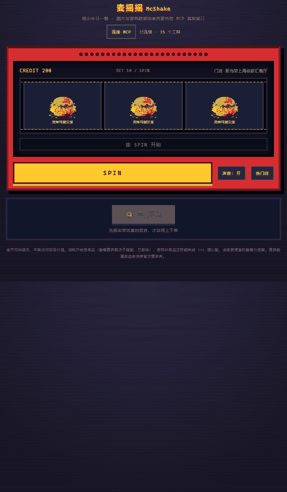
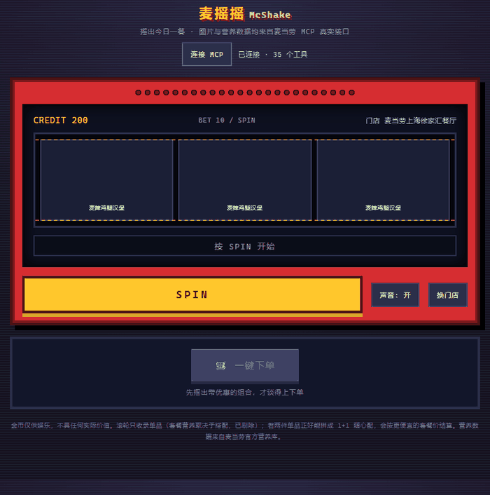

# 麦摇摇 McShake · 麦当劳营养账本与凑单优化器

> 2026 麦当劳程序员创意开发大赛参赛作品 · 全程使用 **WorkBuddy** 开发
>
> [](https://nodejs.org) [](#安装方法) [](test.js) [](LICENSE)

摇一摇老虎机，摇出你这一餐的营养账本和最省买法。

> **线上试玩**：<https://mcshake.app.workbuddy.host/?sharecode=AMBVYTIUXU>
> 打开即可摇，**不需要任何 Token**。页面数据来自官方接口的真实快照（含抓取时点与门店名），
> 想摇自己常去的门店，在页面顶部填自己的 MCP Token 即可切到实时接口。详见[线上试玩与演示模式](#线上试玩与演示模式)。

三个滚轮的符号全部取自**你选定门店的真实在售菜单**，停下后立刻给出营养汇总（对标中国食品标签 NRV 参考值）与 `calculate-price` 真实试算金额——每件单价、被分摊到的凑单优惠、相当于打几折，都列清楚。

如果摇出的两件单品正好能拼成 **1+1 随心配**（蓝区一件 + 粉区一件），页面会再算一次套餐价，并把**没进套餐的那件一起计入实付**：单点合计 ¥50.50 → 本单实付 ¥37.40（套餐 ¥13.90 + 板烧鸡腿堡 ¥23.50），省 ¥13.10。三个数字（套餐价、本单实付、单点合计）都写在画面上，不会出现「上面 ¥41.50、下面 ¥13.90」这种对不上的情况。

```
老虎机滚轮（符号 = MCP 真实菜单 + 官方餐品图片）
        │
        ├──▶ 营养匹配 ──▶ 热量 / 蛋白质 / 脂肪 / 碳水 / 钠 + NRV 占比 + 提示
        │
        └──▶ 组合试算 ──▶ 每件单价 + 到手折扣 + 整单实付
```

所有数据均来自麦当劳中国官方 MCP 实时接口，零第三方依赖（Node 22 标准库实现），不缓存伪造、不虚构数字。

## 演示

**点 SPIN**：三个滚轮先后停下，结果面板给出营养账本与真实计价。这一局摇出的 `板烧鸡腿堡` + `麦乐鸡5块`（蓝区）+ `小杯玉米杯`（粉区）里有两件能拼 1+1，于是再走一次套餐价：单点合计 ¥50.50 → 本单实付 ¥37.40（套餐 ¥13.90 + 板烧鸡腿堡 ¥23.50），省 ¥13.10，「一键下单」随之解锁。



> 动图用**演示模式**录制（无 Token），所以顶部带黄色「演示数据」条；菜单、营养库与金额仍是官方接口的真实快照响应。

**换门店**：城市与地标分开填（`杭州` + `三里亭`），命中后整副滚轮符号立刻换成本店在售菜单。



> 动图为真实交互录屏（Playwright + CDP screencast 抓帧），未做任何拼接或美化；金额与营养值都是那一次真实接口调用的返回。

## 线上试玩与演示模式

**<https://mcshake.app.workbuddy.host/?sharecode=AMBVYTIUXU>**

线上试玩是公网的，任何人都能打开，所以**不能**在服务端内置任何人的 MCP Token——那既会泄漏凭据，也会被人刷爆配额，还违反 MCP「个人非商业用途」的条款。这里的做法是把一场真实会话抓成快照，用快照重放：

| 快照里有什么 | 怎么来的 |
|---|---|
| 门店菜单（116 项，含名称与官方餐品图） | `query-meals` + 逐件 `query-meal-detail` |
| 营养库 160 条 | `list-nutrition-foods` 原始响应 |
| 逐件真实单价 32 项（滚轮符号 + 1+1 子件） | 逐件 `calculate-price` |
| 全部 **286 种三连组合**的真实计价结果 | 11 个符号的三元组合逐个 `calculate-price`，含真实优惠与逐件分摊 |
| 两套 1+1 随心配的分区结构与套餐基础价 | `query-meal-detail` 的 `rounds` + 套餐价试算，并用另外两组子件验算 |

`src/demo-mcp.js` 把这个快照包装成一个**同签名的 MCP 客户端**（`callTool` / `getToolSchema` / `callToolWithFallback`），服务端业务逻辑一行都没改：菜单加载、营养匹配、折扣分摊、1+1 拼单照旧跑，只是数据源从网络换成了快照。

三条不能破的底线：

1. **界面必须标明非实时**。页面顶部有黄色「演示数据」条，写明门店、抓取时点、以及「286 种组合的计价结果都是当次的真实响应」。
2. **快照里没有的组合按真实单价合成，不编折扣**；单价也没有的餐品直接返回失败，而不是给个 0。
3. **未覆盖的工具直接报错**（如 `draw-lottery`），不返回假数据。

启动行为：

```bash
node server.js                    # 无 Token → 自动进演示模式，读 demo/demo-snapshot.json
MCD_MCP_TOKEN=xxx node server.js  # 有 Token → 实时接口，演示模式关闭
MCSHAKE_DEMO=0 node server.js     # 强制关掉演示模式
```

页面顶部的「连接 MCP」随时可以填自己的 Token，连上即切到实时接口（快照带来的菜单、营养库、1+1 索引会全部作废并重新拉取）。

快照过期了想更新，重新抓一份即可（约 20 秒、450 次调用）：

```bash
MCD_MCP_TOKEN=xxx node scripts/build-demo-snapshot.js
```

## 目录

- [演示](#演示)
- [线上试玩与演示模式](#线上试玩与演示模式)
- [项目介绍](#项目介绍)
- [目标用户](#目标用户)
- [安装方法](#安装方法)
- [使用示例](#使用示例)
- [工作原理](#工作原理)
- [项目结构](#项目结构)
- [接口](#接口)
- [测试](#测试)
- [边界与合规](#边界与合规)
- [参赛材料](#参赛材料)

## 项目介绍

点麦当劳前最难回答的两个问题是：**这一餐到底吃了多少**、**怎么买最省**。官方 MCP 已经把菜单、营养库、真实计价都开放出来了，但它们是三套割裂的接口，普通用户根本用不上。

麦摇摇把它们串成一次交互：

1. **摇**——三个滚轮的符号是这家店此刻真的在卖的东西（含官方餐品图），不是写死的示例数据；
2. **看**——摇出什么就算什么：营养逐项列出并折算 NRV 单餐占比，价格走 `calculate-price` 真实试算；
3. **懂**——整单优惠被服务端自动算出后，按原价比例分摊回每一件，告诉你「这顿相当于 8.2 折，省了 ¥13.00」。

设计上贯穿一条原则：**宁可留空，也不给看起来正确的错数字**。套餐不猜营养（营养库没有套餐记录，硬匹配会严重低估），售罄商品不编价格（原样透传官方 `code` 与文案），所有数字都能追溯到一次真实接口调用。

## 目标用户

| 人群 | 场景 | 它解决什么 |
|---|---|---|
| 控卡 / 健身人群 | 想吃麦当劳，又怕一餐超掉全天预算 | 三个餐品的热量、蛋白、脂肪、碳水、钠一眼看清，附 NRV 占比 |
| 学生党 / 价格敏感用户 | 想凑到组合优惠，但不知道还差几块、值不值 | 真实试算整单，列出每件分摊后的单价与折扣力度 |
| 选择困难症 | 站在点餐机前刷了五分钟菜单 | 摇一摇直接出结果，还能顺带看这顿"账" |
| 减脂期但嘴馋的人 | 明知道热量高，需要一点情绪价值 | 超标的营养项配无厘头彩蛋（「只要吃得爽，热量不存在」），不制造焦虑 |
| MCP / Agent 开发者 | 想抄一份官方 MCP 的实测接入笔记 | `MCP_INTEGRATION.md` 记录了大量未公开的参数与响应坑 |

## 安装方法

**环境要求**：Node.js 22 或更高。**无需 `npm install`**——项目零第三方依赖。

```bash
git clone https://github.com/gundamli/McShake.git
cd McShake
node server.js
# 打开 http://127.0.0.1:8787
```

可选：用环境变量直接带上 Token 启动，省去页面里手动填写。

```bash
MCD_MCP_TOKEN=你的Token node server.js
```

MCP Token 在 [open.mcd.cn/mcp](https://open.mcd.cn/mcp) 申请（登录 → 控制台 → 激活 → 复制）。Token 只驻留在服务进程内存，不写磁盘、不进浏览器存储、不入库。

> 需要把麦当劳 MCP 配到其他客户端（Claude / Cherry Studio / WorkBuddy 等）？见 [`mcp-config.example.json`](mcp-config.example.json) 与 [`MCP_INTEGRATION.md`](MCP_INTEGRATION.md)。

## 使用示例

### 1. 四步就用完

| 步骤 | 操作 | 说明 |
|---|---|---|
| ① 连接 | 点标题下方的「连接 MCP」，粘贴 Token | 也可用 `MCD_MCP_TOKEN` 环境变量跳过 |
| ② 选店 | 点「换门店」，分「城市」「地标」两栏填（如 城市=`杭州`、地标=`三里亭`） | 城市栏只认城市名，两栏混填会搜不到；列表标注「营业中 / 已打烊」 |
| ③ 摇 | 点拉杆或按钮 | 三个滚轮停位由概率表驱动，不是三列独立随机 |
| ④ 看 | 结果面板 | 营养汇总 + 每件单价 + 整单折扣 + 提示；能拼 1+1 时给出套餐价与本单实付，此时底部「一键下单」可点 |

### 2. 示例输出

摇出「巨无霸 + 中薯条 + 可口可乐(中)」时，页面大致长这样（数值随门店、时段、菜单变化，仅示意版式）：

```text
这一餐（三件）
  巨无霸          ¥27.00
  中薯条          ¥12.50
  可口可乐(中)    ¥10.50

原价 ¥50.00 · 组合优惠 -¥3.00 · 实付 ¥47.00
相当于 9.4 折，省 ¥3.00

营养（单餐）
能量   1002 kcal  蛋白质 31 g   脂肪 41 g
碳水   129  g     钠     1181 mg
· 钠 1181 mg 已超过单餐参考值（约 660 mg），换杯无糖的会更稳
· 只要吃得爽，热量不存在（本条为彩蛋文案，非营养建议）
```

> 巨无霸与中薯条的营养、钠含量取自官方营养库真实记录（513 kcal / 961 mg、289 kcal / 190 mg），饮品按同类中杯估算；加总规则与页面一致：逐项相加后折算 NRV，不做美化。

终端启动输出：

```text
$ node server.js
  麦摇摇 McShake · 麦当劳营养账本与凑单优化器
  访问 http://127.0.0.1:8787
  也可通过环境变量自动连接：MCD_MCP_TOKEN=xxx node server.js
```

### 3. 常见问题

- **搜不到门店**：`city` 必须是城市名（`杭州`），门店全名要塞进「地标」栏。接口无分页，每次返回最近 5 家，弹窗支持多次搜索累积去重。
- **菜单是空的**：该店已打烊。`query-meals` 对打烊门店正常返回但餐品为空，`calculate-price` 会回 `60003 门店暂停营业`。
- **某件商品算不出价**：菜单按时段动态变化，商品可能在菜单里但不可售。整单被拒时会自动降级为逐件试算，并指出是哪一件买不了。
- **1+1 没出现**：随心配按餐段供应。早餐时段菜单里没有它，页面会写「本时段没有供应」；也可能这单的两件不属于同一套餐的不同分区。
- **营养数据显示「MCP 营养库里没有它」**：那是新品——官方营养表更新比菜单慢。本项目不拿相近单品顶替，宁可留空。

## 工作原理

### 1. 营养匹配阈值 0.55

低于阈值说明规格或品类可能不同（「中薯条」与「大薯条」相似度仅 0.475），此时关联价格的风险高于收益，宁可留空并说明原因。

### 2. 参数三级降级

官方只公开了工具名与描述，没有参数 schema。处理顺序：模板优先（`data/tool-templates.json`）→ `tools/list` 真实 schema 启发式推断 → 候选参数组逐个重试。门店查询就是第三级救回来的。

### 3. 老虎机的三个取舍

| 取舍 | 原因 |
|---|---|
| 开奖由概率表驱动，而非三列独立随机 | 独立随机的三连概率仅约 0.2%，玩一百次都中不了，游戏没有正反馈 |
| 滚轮只收单品，套餐全部剔除 | 套餐营养取决于搭配，营养库没有对应记录；价格只有组合价、拆不出单件单价 |
| 装载滚轮时预检可售性 | 菜单按时段动态变化，商品会出现在菜单里却下不了单。预检可提前发现并标注 |

### 4. 计价归一化与折扣分摊

`productList[].subtotal` 是服务端给出的**已分摊优惠后的单品小计**，优先采用；当各行优惠合计与整单 `discount` 对不上时，按原价比例二次分摊，尾差由最后一行吸收，保证「各行相加 = 整单实付」。

### 5. 1+1 随心配：套餐不进滚轮，但可以拼

滚轮只收单品（套餐拆不出可信营养与单价），可这两件事并不矛盾——**1+1 恰恰是把两个单品拼成一个组合价**。所以：

- 装载滚轮时顺手缓存这家店的随心配分区结构（`query-meal-detail` 的 `rounds[]`：蓝区主食 + 粉区小食/饮品，每项带 `diffPrice`）
- 开奖后检查摇出的三件里是否存在「同套餐、不同分区」的一对；命中就用 `roundList` 调一次 `calculate-price`，拿到套餐价
- 与单点合计比较：实测 `那么大鸡排 + 小杯玉米杯` 单点 ¥27.00，套餐 **¥13.90**（服务端把 `-¥1` 差价也算了进去）
- **剩下那件不能丢**：套餐只吃掉两件，第三件仍按单点算，所以拼单报价 = 套餐 + 剩余单品。这三样一起再试算一次（实测 1490 + 2350 = 3840），得出的是「本单实付」；「省了多少」以整单单点合计为基准，而不是套餐内那两件——否则 ¥37.40 的单子会被写成「省 ¥13.10、7.4 折」以外的数
- 三个数各司其职：`combo.payable`（套餐价）、`combo.totalPayable`（本单实付）、`combo.baseTotal`（单点合计），前端据此渲染，避免口径混淆

早餐时段菜单里没有随心配，此时索引为空，页面提示「本时段没有供应」——这是正常结果，不是接口失败。

接口契约与踩坑记录（金额单位是「分」、字段名写错静默返回 0、`success:false` 不带 data 层等）全部写在 [`MCP_INTEGRATION.md`](MCP_INTEGRATION.md)。

## 项目结构

```text
.
├── server.js                # 零依赖 HTTP 服务：路由 + MCP 会话 + 菜单/开奖/计价编排
├── public/
│   └── slot.html            # 单页前端：像素风老虎机、门店弹窗、结果面板、8bit BGM
├── src/
│   ├── mcp-client.js        # 自研 MCP Streamable HTTP 客户端（SSE/JSON、会话、限流）
│   ├── store-query.js       # 城市/关键词拆分与候选组重试
│   ├── slot.js              # 符号精选、概率表开奖、赔付
│   ├── nutrition.js         # 餐品→营养匹配、NRV 计算、彩蛋文案
│   ├── combo.js             # 1+1 随心配分区索引、拼单匹配、套餐折扣
│   ├── demo-mcp.js          # 演示模式：把官方数据快照包装成同签名的 MCP 客户端
│   └── optimizer.js         # 计价结果归一化、折扣分摊、折扣文案
├── demo/
│   └── demo-snapshot.json   # 线上试玩用的官方数据快照（238 KB，含 286 种组合的真实计价）
├── scripts/
│   └── build-demo-snapshot.js  # 重新抓取快照（约 20 秒）
├── test.js                  # 核心算法自测（155 项，无需 Token）
├── test-integration.js      # 协议层集成测试（27 项，内置模拟 MCP 服务）
├── docs/
│   ├── demo-spin.gif        # 操作演示：SPIN → 停位 → 营养与计价 → 命中 1+1
│   └── demo-store.gif       # 操作演示：换门店弹窗搜索并切换
├── mcp-config.example.json  # 脱敏 MCP 配置示例（仅环境变量占位符）
├── MCP_INTEGRATION.md       # MCP 接入说明与实测契约
├── workbuddy.md             # WorkBuddy 开发对话存档
├── CONTEST_DECLARATION.md   # 参赛声明（官方原文）
└── ISSUE_BODY.md            # 报名 Issue 的提交文本
```

> `data/`、`public/img/slot/` 为运行时缓存（菜单缓存、官方 CDN 图片），已在 `.gitignore` 中排除，首次运行自动生成。

## 接口

| 方法 | 路径 | 说明 |
|---|---|---|
| GET | `/api/health` | 连接状态、工具数、当前门店与营业状态、营养库/菜单数量 |
| POST | `/api/mcp/connect` | 连接 MCP 并拉取工具列表 |
| GET | `/api/mcp/tools` | 工具列表与参数 schema |
| POST | `/api/mcp/call` | 透传调用任意工具（排障用） |
| POST | `/api/stores` | 查询门店（`city` + `keyword` 分离，内部按候选组重试） |
| POST | `/api/store/select` | 选择门店并加载菜单 |
| POST | `/api/store/clear` | 清空门店上下文 |
| GET | `/api/slot/symbols` | 滚轮符号集（真实餐品图片 + 营养 + 单价 + 可售状态） |
| POST | `/api/slot/result` | 按三个餐品编码返回营养汇总、计价试算、1+1 拼单判断与健康提示 |

页面唯一入口是 `/`（等价于 `/slot.html`）。

## 测试

```bash
node test.js              # 155 项，核心算法（无需 Token、不联网）
node test-integration.js  # 27 项，协议层（内置模拟 MCP 服务）
```

共 182 项断言，覆盖符号精选、概率支付表、开奖画面一致性（5000 次循环）、营养匹配与 NRV、计价归一化与折扣分摊、1+1 分区索引与拼单匹配、门店参数拆分、SSE/JSON 双格式握手、会话保持、401/429、限流、官方表格格式解析、混合文本 JSON 提取，以及演示快照的自洽性（三连命中快照原样返回、套餐价 = 基础价 + 差价、未知餐品不给假价格）。

## 边界与合规

1. **不提供自动下单**。页面底部「一键下单」是占位按钮，点击只提示规划中；`create-order`、`mall-create-order`、`party-order-create` 会产生真实支付链接，本项目一律不调用。
2. **不碰抽奖**。`draw-lottery` 原子扣减积分且不可撤销，本项目只在早期调研时用过只读的 `query-lottery-info`。
3. **限流**。每个 Token 每分钟 600 次请求，客户端内置令牌桶，超额排队而非直接失败。
4. **Token 安全**。仅存于服务进程内存，不落盘、不入库；仓库已排除所有可能含凭证的调试产物。
5. **营养口径**。数据来自官方 `list-nutrition-foods`，NRV 按单餐 33% 折算，仅供参考，不构成医疗或营养建议。
6. **素材版权**。滚轮餐品图片来自麦当劳官方 CDN（`menu-img.mcd.cn`），属麦当劳版权素材，**不随本仓库分发**，首次运行时自动下载到本地缓存。
7. **服务条款**。麦当劳 MCP 仅限个人非商业用途，使用时须遵守其《使用条款》与《MCP 服务规则》。
8. **许可**。代码以 [MIT](LICENSE) 授权；但麦当劳 MCP 服务、餐品图片与商标仍归麦当劳所有，不在本仓库授权范围内。

## 参赛材料

| 文件 | 对应要求 |
|---|---|
| `README.md` | 项目介绍、安装方法、使用示例、目标用户 |
| `CONTEST_DECLARATION.md` | 参赛声明（官方原文，未作任何改动） |
| `MCP_INTEGRATION.md` | 实际使用的 McDonald's MCP Server、Tool、调用流程与业务价值 |
| `mcp-config.example.json` | 脱敏 MCP 配置示例，仅环境变量占位符 |
| `workbuddy.md` | WorkBuddy 开发对话存档 |
| `server.js` / `src/` / `public/` | 项目源代码与可运行内容 |

本项目为麦当劳程序员节创意开发大赛参赛作品，由参赛者独立开发，非麦当劳官方产品。项目输出仅供参考；餐品信息、价格及供应状态以麦当劳官方渠道的实时结果为准。
